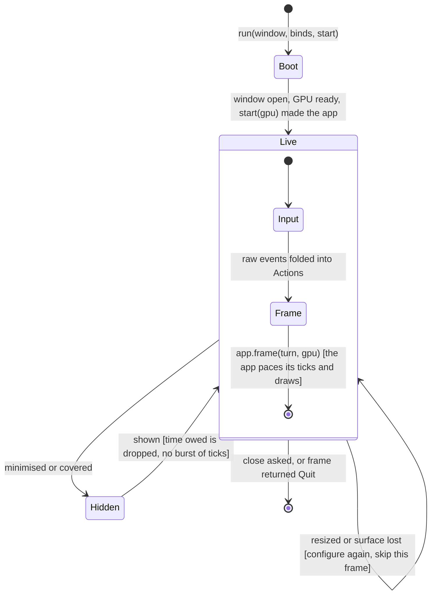

# loom-app

The window and its event loop through `winit`, the pacer that turns real time into simulation ticks, and an
input layer that turns keys, mouse and gamepad into the caller's own actions. It knows no game type; the tick
rate is handed in. Gamepads are read through `gilrs` on macOS and Windows; on Linux the layer builds with no
device behind it, so CI needs no system package.

## Shapes

```rust
pub trait App {
    type Action: Copy + Ord;
    fn frame(&mut self, turn: &Turn<Self::Action>, gpu: &mut Gpu) -> Next;
}
pub struct Turn<'a, A> { pub actions: &'a Actions<A>, pub dt: f32, pub size: (u32, u32) }
pub enum Next { Go, Quit }
pub fn run<G: App>(window: WindowSpec, binds: Binds<G::Action>, start: impl FnOnce(&mut Gpu) -> G) -> ExitCode;

pub enum Source {
    Key(KeyCode), Mouse(MouseButton), Wheel, Drag(MouseButton, Axis),
    Pad(PadButton), Stick(PadAxis),
}
pub struct Bind { pub from: Source, pub scale: f32 }
pub struct Binds<A>(pub Vec<(A, Bind)>);

impl<A: Copy + Ord> Actions<A> {
    pub fn value(&self, action: A) -> f32;
    pub fn held(&self, action: A) -> bool;
    pub fn pressed(&self, action: A) -> bool;
}

impl Pacer {
    pub fn new(ticks_per_second: u32) -> Self;
    pub fn add(&mut self, dt: f32, speed: u32) -> u32;
    pub fn alpha(&self) -> f32;
}
```

- An action's `value` is the sum of its sources, each times its `scale`, clamped to -1 to 1. A key or a button
  is 0 or 1; a stick has a dead zone. `pressed` is true on the frame the value leaves 0. The caller asks for
  actions, never for a key or a button.
- `Actions::feed` takes one raw `Input` (a key, a mouse button, the wheel, the cursor's move, a pad button
  or a stick) and `Actions::step` folds the frame's input into the values; the loop calls both, and a test can.
- `Pacer::add` returns the whole ticks now due, at most 8 a frame; time beyond that is dropped, so a slow
  frame slows the simulation and never freezes it. `alpha` is how far the clock is into the next tick, 0 to 1,
  for drawing between two ticks.

## The loop

One thread runs input, the caller's ticks and the draw.



## Usage

```rust
struct Demo { pacer: Pacer, /* the caller's world */ }

impl App for Demo {
    type Action = Action;
    fn frame(&mut self, turn: &Turn<Action>, gpu: &mut Gpu) -> Next {
        for _ in 0..self.pacer.add(turn.dt, 1) { /* one tick of the caller's simulation */ }
        let alpha = self.pacer.alpha();
        /* build a Scene between the last two ticks at alpha, then gpu.render(&scene) */
        if turn.actions.pressed(Action::Quit) { Next::Quit } else { Next::Go }
    }
}
```
