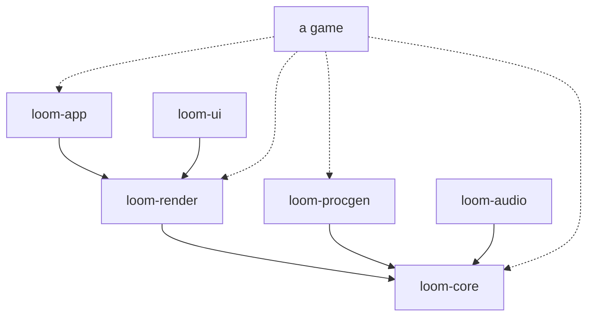

# Crates

## The map

```
crates/loom-core/      built     ticks, ids, random streams, canonical writer and state hash, state registry,
                                 input log, save header, the single-threaded schedule runner
crates/loom-procgen/   built     seeded terrain and chunk meshes, soft-part meshes; planned: a fibre texture, a sky
                                 (procgen.md)
crates/loom-render/    planned   the wgpu renderer; the one crate that may hold `unsafe` (render.md)
crates/loom-app/       planned   the winit window and loop, the pacer, input actions (app.md)
crates/loom-ui/        later     an in-game UI, after its own decision
crates/loom-audio/     later     sound, when a game first needs it
xtask/                 built     `cargo xtask check`; the graph test and its fixtures
ci/sim-lints/          built     the determinism lint list, its runner, its fixtures (determinism.md)
```

A planned crate is created by the first change that needs it, never before. Its rules below hold from the
day it exists.

## Who may depend on whom



An arrow is "may depend on"; no arrow, no dependency. `loom-render` knows no terrain and `loom-procgen` knows
no GPU: only a game names both. No arrow points from loom to a game: `deny.toml` allows no git source.
`xtask` links no workspace crate; it starts `cargo` and gatekeeper as processes.

## The rules and their enforcers

Rule numbers are given once and never reused; a gap is a rule that does not apply to this repo.

| # | Rule | Enforcer |
|---|---|---|
| R4 | `loom-core` depends on no other workspace crate | the graph test; fixture `core-uses-procgen` |
| R5 | `#![forbid(unsafe_code)]` in every crate root | the graph test reads each `loom-*` crate root for the attribute, fixture `forbid-missing`; `unsafe_code = "forbid"` workspace-wide (`Cargo.toml`, gatekeeper's `rust/bans`). The planned `loom-render` is the one crate that may lift it: its exemption and the check that each of its `unsafe` blocks has a `// SAFETY:` line land with that crate, not before |
| R6 | `bevy_ecs` is built without its `multi_threaded` feature; `glam` with `libm` | the graph test, on resolved features; fixtures `ecs-multi-threaded`, `glam-without-libm` |
| R7 | A source file is at most 600 lines | `.drover/arch.toml` `[[size]]` on `crates/*/src/**/*.rs` and `xtask/src/**/*.rs` |
| R10 | Only binaries touch files: no `std::fs` in a library | `.drover/arch.toml` `[[ban]]` of `std::fs` in `crates/*/src/**` |

**The graph test** is `xtask/tests/crate_rules.rs`. It reads `cargo metadata --locked`, walks the resolved
graph and checks R4, R5 and R6. Each rule is proven by a tiny workspace under
`xtask/tests/fixtures/crate-rules/` that must fail it and nothing else, and `clean` must pass. It runs in
`local/test` on every pull request. A text search cannot see a dependency or a feature that arrives through
another crate; the resolved graph can.

## Inside the planned crates

| Crate | May use | Never |
|---|---|---|
| `loom-procgen` | `loom-core` ids, `glam`, `libm`, `serde` | threads, a clock, files, `wgpu` |
| `loom-render` | `wgpu`, `glam`, `bytemuck` | `winit`, `loom-procgen`, any type of a game |
| `loom-app` | `winit`, `gilrs`, `loom-render` | any type of a game; the tick length is handed in |
